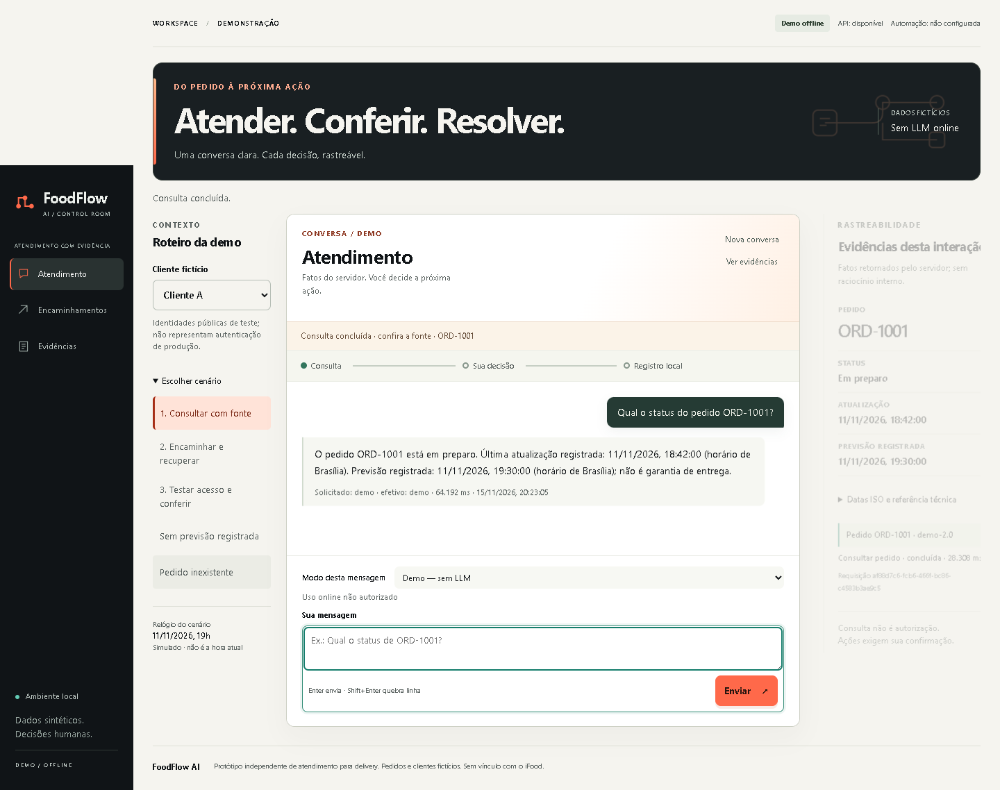
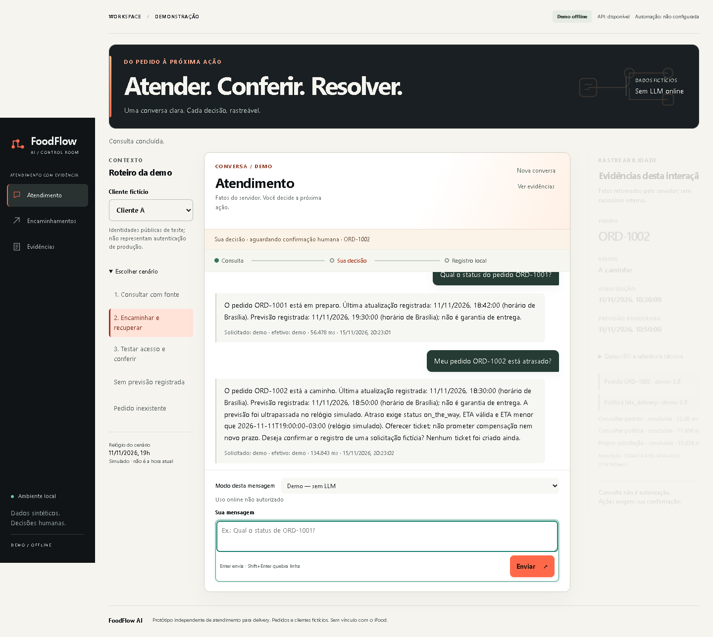
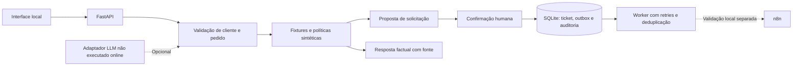
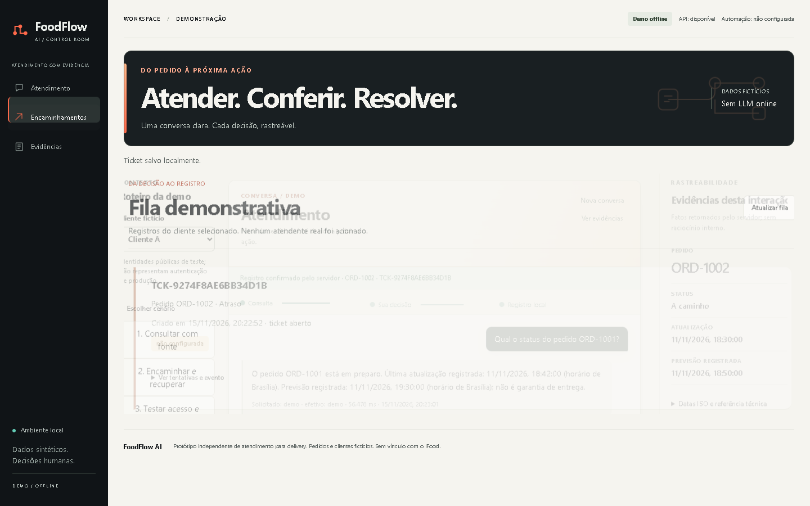
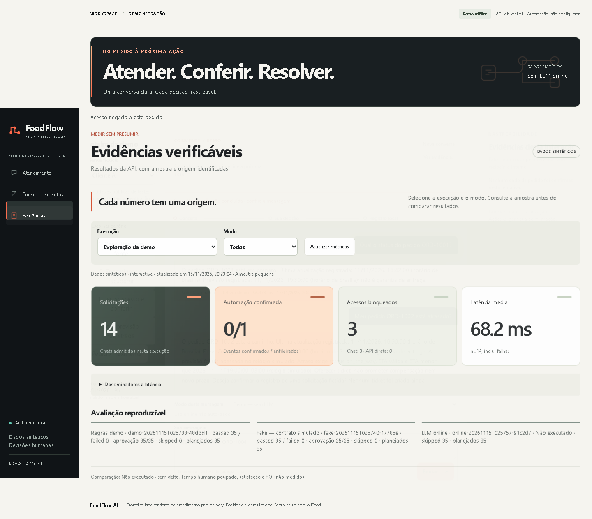

# FoodFlow AI

**Atender. Conferir. Resolver.** Um protótipo local de atendimento para delivery que transforma consultas sobre pedidos fictícios em respostas verificáveis e, quando necessário, em solicitações registradas **somente após confirmação humana**.

**Projeto independente, sem vínculo com o iFood.** Desenvolvido para estudo e portfólio com assistência do Codex, orientação e validação do responsável pelo projeto. Não houve treinamento de modelo próprio, atendimento de clientes reais nem integração com dados de produção.

[](media/foodflow-demo-29s.webm)

**[Ver vídeo de 29 segundos](media/foodflow-demo-29s.webm)** · [Conhecer a arquitetura](docs/ARCHITECTURE.md) · [Ver evidências dos testes](docs/VERIFICACAO.md) · [Read in English](README_EN.md)

## O que você consegue demonstrar

| Cenário | O que acontece |
|---|---|
| **ORD-1001 — Consulta com fonte** | Cliente A recebe o status, a previsão registrada e a fonte fictícia dos dados. A previsão não é promessa de entrega. |
| **ORD-1002 — Solicitação por atraso** | O sistema verifica o pedido e a política, propõe um ticket e só registra a solicitação quando a pessoa clica em **Confirmar registro**. O ticket permanece no SQLite após reiniciar. |
| **ORD-1004 — Bloqueio de acesso** | O Cliente A tenta consultar um pedido que não lhe pertence; a API nega a consulta sem divulgar os dados do pedido. |



A interface **Motion Showcase V2** tem animações de navegação, estados de atendimento, trilho de confirmação, visualização de evidências e suporte a movimento reduzido. As animações não simulam operações que ainda não aconteceram.

## Executar

### Opção 1 — Executável Windows (para demonstração)

O binário não está no histórico de código: será disponibilizado separadamente na área **Releases** deste repositório após o envio do pacote de lançamento. Extraia o pacote Windows, abra `FoodFlow AI.exe` e mantenha a janela de controle aberta enquanto usa o navegador. A janela oferece **Abrir interface**, **Nova demo** e **Encerrar**. Não é necessário instalar Python na máquina que executa o programa, mas um teste em Windows limpo sem Python ainda não foi realizado. [Instruções completas](docs/EXECUCAO.md).

### Opção 2 — Executar pelo código-fonte

Requer Python 3.12. No PowerShell, dentro da pasta do repositório:

```powershell
py -3.12 -m venv .venv
.\.venv\Scripts\python.exe -m pip install -r backend\requirements.txt
.\.venv\Scripts\python.exe scripts\run_local.py
```

Abra `http://127.0.0.1:8000`. A demonstração padrão é **offline**, com SQLite e dados fictícios; não exige chave OpenAI nem n8n. A instalação das dependências necessita de internet. O servidor é local (`127.0.0.1`) e não deve ser exposto publicamente.

## Arquitetura resumida



Há controles de titularidade no servidor, confirmação explícita antes de ações persistentes, deduplicação de eventos e arquitetura de outbox/inbox para recuperação de automação. A demo distribuída **não inicia n8n**: a integração real foi validada separadamente e suas evidências históricas estão documentadas. [Detalhes da arquitetura](docs/ARCHITECTURE.md).

## Evidências e limitações

| Verificação | Resultado reportado e escopo |
|---|---|
| Testes automatizados | **118 aprovados, 2 ignorados** na execução Windows final: 112 do backend + 6 do iniciador |
| Avaliações offline | **86/86**: 35 demo, 35 fake roteirizadas, 8 demo de piloto, 8 fake de piloto |
| API / navegador | **6 testes HTTP** e **49 verificações de navegador** no executável final |
| Integração n8n | **N01–N08 aprovados** em execução local anterior, com 16 registros correlacionados; não está incluída no EXE |
| Modelo online | **Não executado**; os testes fake não correspondem a inferências de um LLM real |
| CI remoto / deploy | Ainda **não executados**; o workflow foi mantido com disparo manual para evitar execução automática na primeira publicação |

Esses números representam testes delimitados, **não** taxas de sucesso com clientes nem prontidão para produção. Há identidades fictícias públicas e métricas sem autenticação operacional; por isso o aplicativo não é adequado para hospedagem aberta sem desenvolvimento adicional. Consulte o [escopo dos testes e provas](docs/VERIFICACAO.md).

## Tecnologias

Python 3.12 · FastAPI · SQLite · HTML/CSS/JavaScript · PyInstaller (Windows) · n8n (integração local validada separadamente) · GitHub Actions (configuração ainda não executada remotamente).

## Galeria

| Encaminhamentos | Evidências |
|---|---|
|  |  |

[Captura mobile](media/mobile.png) · [Bloqueio de acesso](media/acesso-negado.png)

## Como verificar

```powershell
.\.venv\Scripts\python.exe -m pytest backend\tests -q
.\.venv\Scripts\python.exe scripts\evaluate.py --mode all-offline
.\.venv\Scripts\python.exe scripts\evaluate.py --pilot --mode all-offline
```

A suíte online é opt-in e não deve ser executada sem autorização explícita para uso de provedor externo. [Guia de execução](docs/EXECUCAO.md) · [Workflow e resultados n8n](docs/N8N_VALIDATION.md).

---

**Sobre a autoria:** projeto de portfólio conduzido com direção e validação humanas e implementação assistida pelo Codex. Recursos, métricas e resultados são apresentados com seus limites reais, sem reivindicar vínculo profissional com plataformas de delivery.

**Licença:** [MIT](LICENSE) · Copyright (c) 2026 joseaugustocpedro.
