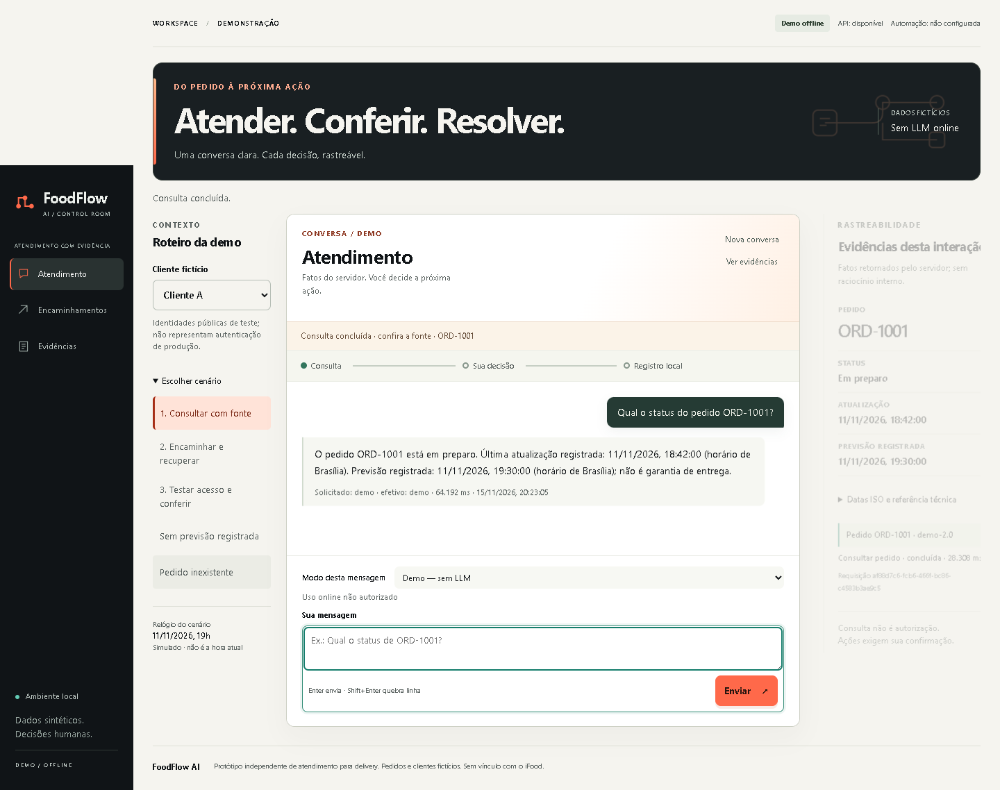

# FoodFlow AI — Local Delivery Support Prototype

**Handle. Verify. Resolve.** A local, synthetic food-delivery support prototype that combines source-grounded order lookups, human-confirmed requests, durable SQLite tickets, and recoverable automation design.

**Independent portfolio project; not affiliated with iFood.** Built with Codex assistance and human direction/review. No live customers, production accounts, or fine-tuned models.

[29-second demo video](media/foodflow-demo-29s.webm) · [Portuguese README](README.md) · [Architecture](docs/ARCHITECTURE.md)

**Three demos:** ORD-1001: authorized lookup with a traceable source; ORD-1002: explicit human confirmation before creating a durable ticket; ORD-1004: cross-customer access denied for Customer A.

**Run from source:** Python 3.12, install `backend/requirements.txt`, then execute `python scripts/run_local.py` and open `http://127.0.0.1:8000`. The default demo needs no online LLM or n8n. Download the packaged Windows build from the [v1.0.0 release](https://github.com/joseaugustocpedro/foodflow-ai/releases/tag/v1.0.0) ([direct ZIP download](https://github.com/joseaugustocpedro/foodflow-ai/releases/download/v1.0.0/FoodFlow_Windows_v1.0.0.zip)); see [Windows instructions](docs/EXECUCAO.md). Do not expose the local server to the public internet.

**Reported validation:** 118 passed + 2 skipped tests (112 backend and 6 Windows launcher), 86 offline evaluation scenarios, 6 HTTP checks, 49 browser checks. Real n8n validation (N01–N08) took place separately on a local runtime, with preserved evidence. The online LLM, remote CI and deployment have **not** been executed. The GitHub Actions workflow is manual-trigger-only pending approval.

Scripted fake-model evaluations are not actual LLM inference. All customers, orders, and policies are synthetic; public demo identities and unauthenticated operator metrics mean this is not production-ready. [Validation evidence](docs/VERIFICACAO.md).

**License:** [MIT](LICENSE) · Copyright (c) 2026 joseaugustocpedro.
